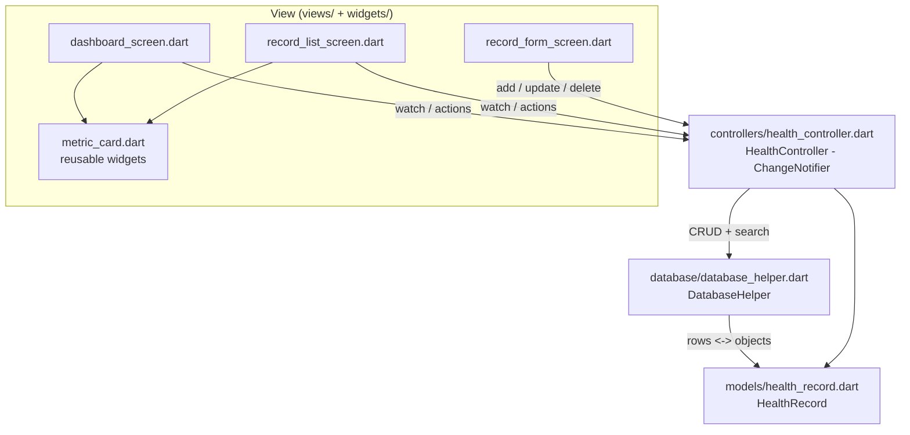

# HealthMate – Personal Health & Wellness Tracker

A Flutter app for recording daily **steps**, **calories burned** and **water intake**, reviewing past days, and tracking progress against daily goals.

> Data is stored on the device in a local **SQLite** database (`healthmate.db`) using `sqflite`, so records stay after the app is closed.

## Features

**Core**
- Add health entries (date, steps, calories, water) with form validation
- View past records grouped by day, with daily totals
- Edit or delete records (swipe left to delete, with **Undo**)
- Search records by date and filter by Today / Last 7 days / This month / custom range
- Dashboard summary of today's activity

**Additional**
- Daily goals (editable) with animated progress rings
- 7-day bar chart per metric, with a goal line
- Activity streak counter and weekly averages
- Quick-add water buttons (+250 ml / +500 ml)
- Daily goals editable by tapping a dashboard card
- Starts in light mode; dark or system theme can be chosen from the app bar menu
- Alexandria font bundled with the app (works offline)
- Responsive layout for small phones (labels scale down, text size capped at 115%)
- Reload sample data / delete all records (Records menu)
- Unsaved-changes warning on the entry form
- Custom launcher icon

## Architecture – MVC + Provider



- **Model** – `HealthRecord` (plus `DailySummary`, `DailyGoals`) with `toMap()` / `fromMap()` for the database.
- **Database** – `DatabaseHelper` (singleton) opens the SQLite database, creates the tables on first launch, inserts dummy data, and runs all queries (parameterised with `?`).
- **Controller** – `HealthController` holds app state, performs CRUD, search/filter and dashboard calculations, and calls `notifyListeners()` so the views rebuild. It is provided to the widget tree with `ChangeNotifierProvider`.
- **Views** – screens that display controller state and send user actions back to it. `widgets/metric_card.dart` contains reusable components (metric card, progress ring, record tile, etc.).

## Project structure

```
lib/
├── main.dart                       # App entry, Provider setup, theme, bottom navigation
├── models/
│   └── health_record.dart          # HealthRecord model + date/number helpers
├── database/
│   └── database_helper.dart        # SQLite (sqflite): tables, CRUD, search, settings, dummy data
├── controllers/
│   └── health_controller.dart      # State, CRUD, search, dashboard logic, validators
├── views/
│   ├── dashboard_screen.dart       # Today summary, goals, weekly chart
│   ├── record_form_screen.dart     # Add / edit form with validation
│   └── record_list_screen.dart     # Record list with search & filter by date
└── widgets/
    └── metric_card.dart            # Reusable UI components
test/
├── health_record_test.dart         # Model
├── database_helper_test.dart       # Real SQL queries on an in-memory SQLite DB
├── health_controller_test.dart     # CRUD, search, dashboard logic
├── validators_test.dart            # Form validation rules
└── widget_test.dart                # UI flows
```

## Colour scheme

| Element | Colour | Reason |
|---|---|---|
| Brand / primary | Teal `#00897B` | Calm and associated with health |
| Steps | Green `#2E9E5B` | Movement and activity |
| Calories | Red `#E5484D` | Energy and burning |
| Water | Blue `#2F80ED` | Universally associated with water |

## Packages

| Package | Why |
|---|---|
| `provider` | Official, lightweight state management – exposes `HealthController` (a `ChangeNotifier`) to every screen |
| `sqflite` | Local SQLite database required by the brief |
| `path` | Builds the database file path safely on each platform |
| `sqflite_common_ffi` (dev) | Runs the same SQLite code in tests on a PC |
| `intl` | Date and number formatting ("18 August 2026", "7,850") |

**Font:** [Alexandria](https://fonts.google.com/specimen/Alexandria) (SIL Open Font License), bundled in `assets/fonts/`.

## Running

```bash
flutter pub get
flutter run
flutter test
flutter build apk --release   # output: build/app/outputs/flutter-apk/app-release.apk
```

## Database

```sql
CREATE TABLE health_records (
  id       INTEGER PRIMARY KEY AUTOINCREMENT,
  date     TEXT    NOT NULL,   -- "yyyy-MM-dd" (sorts correctly as text)
  steps    INTEGER NOT NULL DEFAULT 0,
  calories INTEGER NOT NULL DEFAULT 0,
  water    INTEGER NOT NULL DEFAULT 0  -- millilitres
);
CREATE INDEX idx_health_records_date ON health_records (date);

CREATE TABLE app_settings (key TEXT PRIMARY KEY, value TEXT NOT NULL);  -- goals, theme
```

On first launch the tables are created and 7 dummy records (today and the previous 6 days) are inserted. To start again with fresh sample data, uninstall the app or use **⋮ → Reload sample data** on the Records screen.
