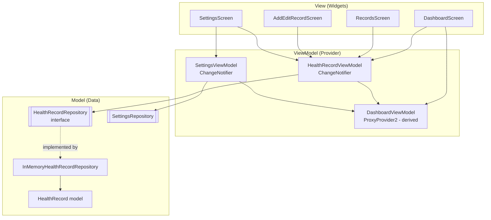

# HealthMate – Personal Health & Wellness Tracker

A Flutter app for recording daily **steps**, **calories burned** and **water intake**, reviewing past days, and tracking progress against daily goals.

> **Current build: frontend only.** Records are kept in memory through an `InMemoryHealthRecordRepository`, so data resets when the app restarts. The app is structured so a SQLite (`sqflite`) repository can be added later without changing any screen or view model (see *Adding SQLite later*).

## Features

**Core**
- Add health entries (date, steps, calories, water) with form validation
- View past records grouped by day, with daily totals
- Edit or delete records (swipe left to delete, with **Undo**)
- Search records by date and filter by Today / Last 7 days / This month / custom range
- Dashboard summary of today's activity

**Additional**
- Daily goals (editable) with animated progress rings
- 7-day bar chart per metric, with a goal line
- Activity streak counter and weekly averages
- Quick-add water buttons (+250 ml / +500 ml)
- Light, dark and system theme
- Reload sample data / delete all records
- Unsaved-changes warning on the entry form
- Custom launcher icon

## Architecture – MVVM + Provider (feature-based)



- **View** widgets only display state and forward user actions.
- **ViewModels** hold UI state and business logic and call `notifyListeners()` after changes.
- **DashboardViewModel** is derived state: `ProxyProvider2` rebuilds it whenever records or goals change, so the dashboard always stays in sync after any add, edit or delete.
- **Repositories** hide where data is stored. ViewModels depend on the interface, not the implementation.

## Project structure

```
lib/
├── main.dart                     # Entry point – creates repositories (dependency injection)
├── app.dart                      # MultiProvider setup, MaterialApp, themes
├── core/
│   ├── constants/                # App constants, HealthMetric enum
│   ├── theme/                    # Material 3 light/dark theme, metric colours & icons
│   └── utils/                    # Date & number formatting, form validators
├── features/
│   ├── health_records/
│   │   ├── data/                 # HealthRecord model, sample data, repositories
│   │   ├── viewmodel/            # HealthRecordViewModel (CRUD, search, filters)
│   │   └── views/                # Records list, Add/Edit form, reusable widgets
│   ├── dashboard/
│   │   ├── viewmodel/            # DashboardViewModel (totals, progress, streak, chart data)
│   │   └── views/                # Dashboard screen, cards, weekly bar chart
│   └── settings/
│       ├── data/                 # DailyGoals model, settings repository
│       ├── viewmodel/            # SettingsViewModel (goals, theme)
│       └── views/                # Settings screen
└── shared/widgets/               # App shell (bottom nav), progress ring, common widgets
test/
├── unit/                         # Validators, model, dashboard logic, CRUD/search view model
└── widget/                       # End-to-end UI flows (validation, add entry -> dashboard)
```

## Colour scheme

| Element | Colour | Reason |
|---|---|---|
| Brand / primary | Teal `#00897B` | Calm and associated with health |
| Steps | Green `#2E9E5B` | Movement and activity |
| Calories | Red `#E5484D` | Energy and burning |
| Water | Blue `#2F80ED` | Universally associated with water |

## Packages

| Package | Why |
|---|---|
| `provider` | Official, lightweight state management, used for MVVM with `ChangeNotifier` and `ProxyProvider` |
| `intl` | Date and number formatting ("18 August 2026", "7,850") |

## Running

```bash
flutter pub get
flutter run
flutter test
flutter build apk --release   # output: build/app/outputs/flutter-apk/app-release.apk
```

## Adding SQLite later

1. Add `sqflite` and `path` to `pubspec.yaml`.
2. Create `SqfliteHealthRecordRepository implements HealthRecordRepository` that uses a `health_records` table (`id` INTEGER PK, `date` TEXT, `steps` INTEGER, `calories` INTEGER, `water` INTEGER). `HealthRecord.toMap()` / `fromMap()` already match these columns.
3. In `main.dart`, replace `InMemoryHealthRecordRepository()` with the new repository.

No changes are needed in the views or view models.
